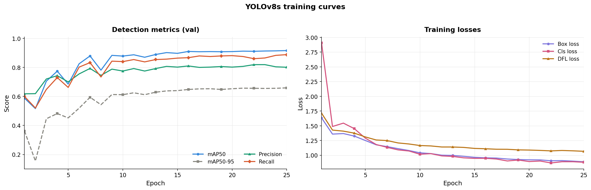
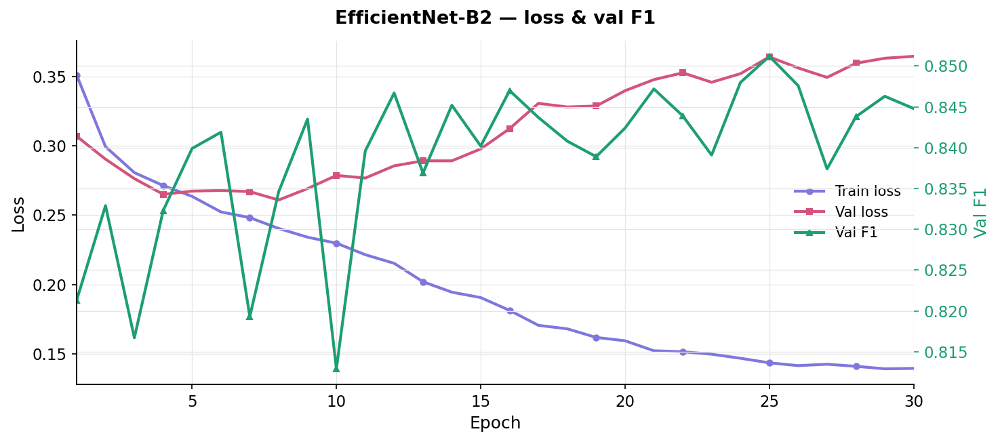
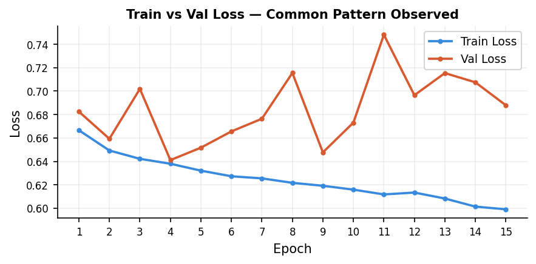

# Mitosis Detector

**Mitotic Figure Detection in Gigapixel Whole-Slide Pathology Images**

[](https://www.python.org/downloads/)
[](https://docs.ultralytics.com/)
[](https://pytorch.org/)

A robust two-stage deep learning pipeline that uses YOLOv8s at a low confidence threshold to favor recall, then refines predictions using an EfficientNet-B2 classifier trained on true positives, false positives and false negatives. The system achieves **F1 = 0.7738** on 11 fully held-out test slides with significant staining variation.

Note that stage-2 cannot recover when stage-1 misses a mitotic figure.

## Why This Matters

Mitotic figure counting is essential for tumor grading in histopathology, yet it remains a manual, time-consuming, and subjective task for pathologists. Whole-slide images (WSIs) are gigabytes in size and contain very large numbers of cells. Staining variations across slides make generalization extremely difficult for conventional models.

This project addresses the problem with a carefully designed two-stage approach that prioritizes both precision and recall.

The repository includes a Dockerized FastAPI endpoint for tile-level inference. It accepts a pathology image tile and returns image-relative coordinates for detected mitotic candidates.

## Key Results

| Split | Precision | Recall | F1    |
|-------|-----------|--------|-------|
| Validation | 0.6981    | 0.8047 | 0.7476 |
| **Test (held-out)** | **0.7700**    | **0.7776** | **0.7738** |

---

## Features

- **Two-stage architecture**: A low-threshold YOLOv8s detector generates candidate mitoses, and an EfficientNet-B2 classifier filters out likely false positives.
- **Efficient large-image handling**: Streams gigabyte-scale DICOM whole-slide images tile-by-tile without loading entire slides into memory.
- **Stage 2 training**: Stage 2 is trained on true positives, false positives and false negatives, helping dramatically improve the decision boundary.
- **Reproducible end-to-end pipeline**: From raw DICOM to final mitotic coordinates with clear checkpoints and evaluation scripts.

## Installation

### Prerequisites
- Python 3.10 or higher
- NVIDIA GPU recommended (training was done on T4 GPUs)
- Kaggle account (for dataset download)

### Step 1: Clone the repository
```bash
git clone https://github.com/shanthan5589/mitosis-detector.git
cd mitosis-detector
```

### Step 2: Install dependencies
```bash
pip install -r requirements.txt
pip install kaggle
```

### Step 3: Set up Kaggle API credentials
1. Go to [kaggle.com](https://www.kaggle.com) → Your Profile → Settings → API → **Create New Token**
2. Place the downloaded `kaggle.json` file at:
   - Linux/macOS: `~/.kaggle/kaggle.json`
   - Windows: `C:\Users\<YourUsername>\.kaggle\kaggle.json`

### Step 4: Download the datasets
```bash
# Training set (21 slides)
kaggle datasets download -d marcaubreville/mitosis-wsi-ccmct-training-set -p "data" --unzip

# Test set (11 slides)
kaggle datasets download -d marcaubreville/mitosis-wsi-ccmct-test-set -p "data" --unzip
```

> **Note**: Each whole-slide image is several gigabytes. Ensure you have sufficient disk space.

### Step 5: Configure paths
Edit `config.py` and set:
- `TRAIN_DATA_DIR` → path to your unzipped training folder
- `TEST_DATA_DIR` → path to your unzipped test folder (for final evaluation)

The scripts expect these metadata files inside each split's `meta_data/` folder:
- `Slides.csv`
- `Annotations.csv`
- `Annotations_coordinates.csv`

If your dataset provides SQLite files instead, generate the CSVs with:
```bash
python setup_data.py --split train
python setup_data.py --split test
```

## Quick Start

Run the steps **in order**. Each step depends on artifacts from the previous one.

```bash
# 1. Extract tiles and prepare YOLO training data
python stage1_yolo/prepare_yolo_data.py

# 2. Train YOLOv8s detector (high-recall stage)
python stage1_yolo/train_yolo.py

# 3. Generate hard-case training data for Stage 2
python stage2_classifier/prepare_stage2_data.py

# 4. Train EfficientNet-B2 classifier
python stage2_classifier/train.py

# 5. Evaluate full pipeline
python evaluate.py --split val
python evaluate.py --split test   # after configuring TEST_SLIDES in config.py
```

### Execution Checklist
Use this to verify successful runs:
- [ ] `yolo_data/data.yaml` is created
- [ ] `models/yolo/weights/best.pt` exists
- [ ] `stage2_data/train/train.csv` and `val/val.csv` are generated
- [ ] `models/stage2_best.pth` is saved
- [ ] `evaluate.py` prints Precision / Recall / F1 scores

## Project Structure
```
mitosis-detector/
├── README.md
├── requirements.txt
├── config.py
├── evaluate.py
├── setup_data.py
├── stage1_yolo/
│   ├── prepare_yolo_data.py
│   └── train_yolo.py
├── stage2_classifier/
│   ├── prepare_stage2_data.py
│   └── train.py
├── yolo_data/          # Generated: tiles + YOLO labels
├── stage2_data/        # Generated: hard-case crops + CSVs
├── models/             # Generated: trained weights
└── data/               # Your downloaded Kaggle datasets
```

## How It Works

### The Problem with Single-Stage Approaches
Initial experiments treated mitosis detection as simple binary patch classification (64×64 patches → ResNet-18 / EfficientNet-B0).

**Why it failed**:
- Models quickly overfit to slide-specific staining patterns.
- Training loss decreased while validation loss diverged.
- Best validation F1 remained stuck around **0.41**.
- The model learned trivial negatives (plain tissue, granulocytes) instead of focusing on hard lookalikes.


### The Solution: Two-Stage Pipeline

**Stage 1 — YOLOv8s Detector (low threshold)**
- Input: The code extracts native DICOM tiles and YOLO resizes them to 640×640.
- Confidence threshold deliberately set low (`0.10`) to minimize missed mitoses.
- Accepts more false positives to reduce the number of missed candidates.
- Mosaic / mixup augmentation disabled (they distort cell morphology)

**Stage 2 — EfficientNet-B2 Classifier**
Trained **only** on three types of crops:
| Crop Type       | Label | Purpose |
|-----------------|-------|---------|
| True Positive   | 1     | Real mitoses correctly detected by YOLO |
| False Negative  | 1     | Real mitoses missed by YOLO |
| False Positive  | 0     | Non-mitotic cells that fooled YOLO |

This focuses model capacity exactly where it matters: distinguishing real mitotic figures from visually similar impostors.

## Results

### Performance on Unseen Data (Test Slides)
| Metric     | Validation | Test (11 slides) |
|------------|------------|------------------|
| Precision  | 0.6981     | 0.7700           |
| Recall     | 0.8047     | 0.7776           |
| **F1**     | 0.7476     | **0.7738**       |

### Training Curves




## Key Learnings

- **Training on hard negatives is critical** — Training on random negatives is insufficient when the real challenge is visually similar lookalikes.
- **Slide-level splits are non-negotiable** in medical imaging. Random splits produce misleadingly high metrics.
- **DICOM streaming** (`iter_pixels`) is essential — loading full WSIs into memory is impractical.
- **Input context matters** — The earlier 64×64 patches contained less surrounding tissue than the 96×96 Stage 2 crops. Stage 1 processes complete native DICOM tiles, which YOLO resizes internally to 640×640.

## Contributing
Read the [CONTRIBUTING](CONTRIBUTING) file for guidelines on how to contribute to this project.

## Acknowledgements

This project would not be possible without the outstanding dataset and annotations provided by:

**Bertram, C. A., Aubreville, M., Marzahl, C., Maier, A., & Klopfleisch, R. (2019).**  
A large-scale dataset for mitotic figure assessment on whole slide images of canine cutaneous mast cell tumor.  
*Scientific Data*, 6(274), 1–9. https://doi.org/10.1038/s41597-019-0290-4

Dataset access:
- [Training Set](https://www.kaggle.com/datasets/marcaubreville/mitosis-wsi-ccmct-training-set)
- [Test Set](https://www.kaggle.com/datasets/marcaubreville/mitosis-wsi-ccmct-test-set)

Special thanks to the pathologists who performed the exhaustive 262,481 expert annotations across 32 whole-slide images.

## License
This project is released under the [MIT License](LICENSE).
